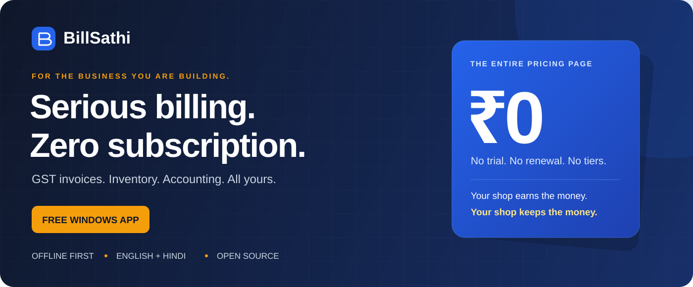
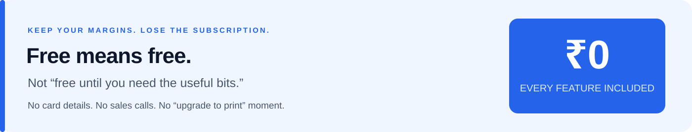
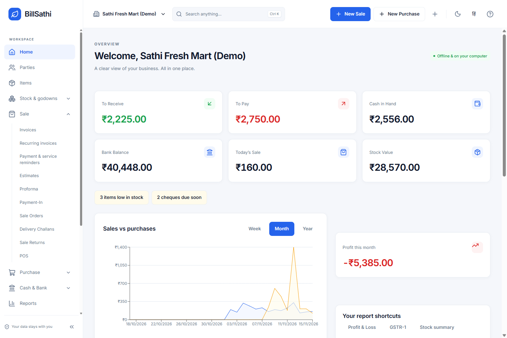
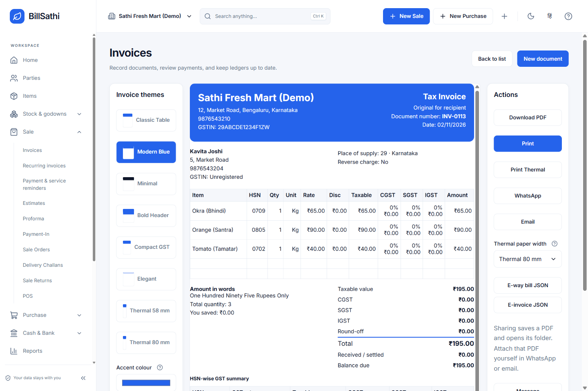
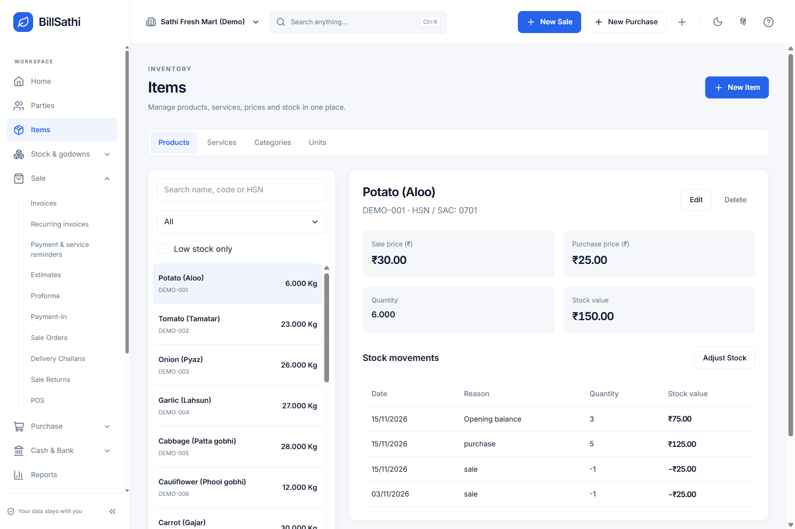
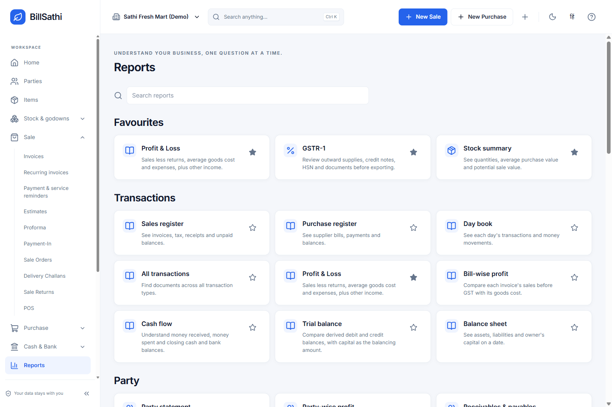
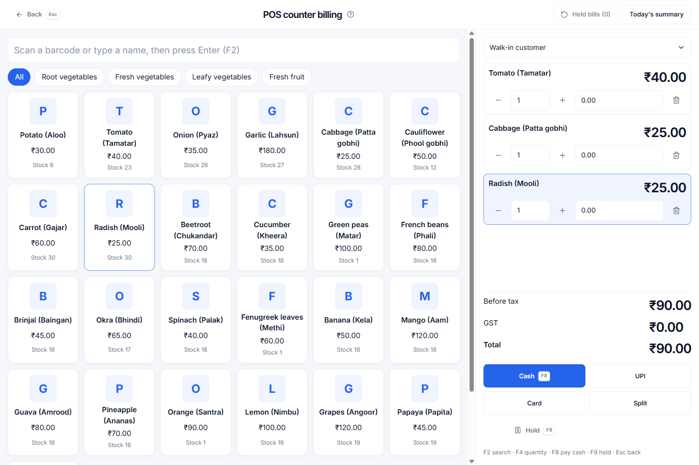
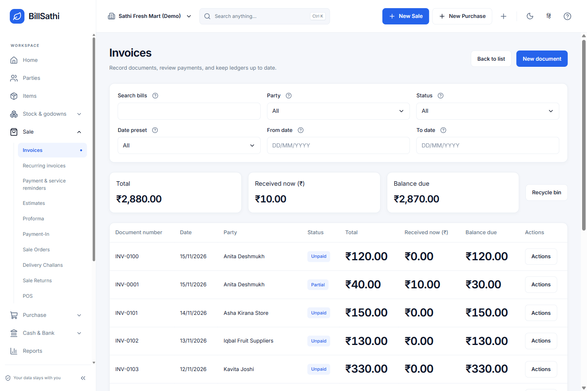
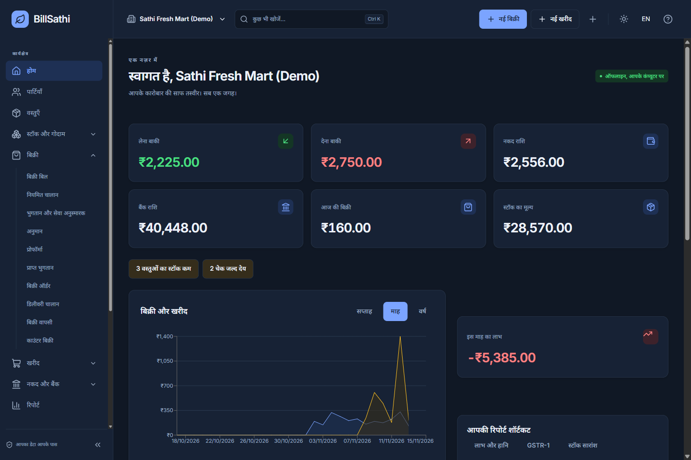

<div align="center">



<br />

**Free GST billing & accounting for Indian small businesses.**

Your counter. Your customers. Your computer. Your data.

[](https://github.com/tungaantu/BillSathi/releases/latest)

**[Latest release](https://github.com/tungaantu/BillSathi/releases/latest)** · **[Screenshots](#see-billsathi-in-action)** · **[Features](#everything-your-counter-needs)** · **[Get started](#from-download-to-your-first-bill)** · **[FAQ](#questions-before-you-switch)**

**₹0 subscription** &nbsp; / &nbsp; **Works offline** &nbsp; / &nbsp; **English + हिन्दी** &nbsp; / &nbsp; **MIT licensed**

</div>

---

## Your billing app should send invoices. Not renewal reminders.

Running a shop is expensive enough. Why pay a subscription just to make the next bill?

BillSathi brings GST invoices, counter billing, purchases, inventory, customer balances and reports into one Windows app. Use the keyboard to keep the queue moving. Print a proper invoice. Close the day knowing what came in, what went out, and who still owes you.

**No trial countdown. No credit card. No paid feature tiers. No sales-call detour before you can start.**



> Some software has a pricing plan for every button. We put the buttons in the app.

## Download BillSathi — free for Windows

**[Open the latest release →](https://github.com/tungaantu/BillSathi/releases/latest)**

1. Open **Assets** on the release page.
2. Download **`BillSathi-Setup-0.1.0.exe`** for the first release, or the matching `BillSathi-Setup-<version>.exe` on a newer release.
3. Run the installer, choose your folder, and open **BillSathi** from the desktop or Start menu.
4. Choose **Start fresh** for your business or **Try with demo data** to explore first.

| What you need     | Details                                                     |
| :---------------- | :---------------------------------------------------------- |
| Computer          | Windows 10/11, 64-bit Intel or AMD processor                |
| Installer         | The `.exe` under **Releases → Assets**                      |
| Internet          | Needed to download; core billing works offline              |
| Account           | No BillSathi account or GitHub account required to download |
| Cost              | **₹0. All included app features. No subscription.**         |
| Developers' tools | Not required to install or use the app                      |

**Choose the installer, rather than “Source code (zip)”.** The source archives are for developers. macOS, Linux and native Windows ARM installers are not provided in this release.

The current installer is **unsigned**, so Windows may show an unknown-publisher or SmartScreen message. Check that the download came from this repository's Releases page. Each release includes `SHA256SUMS.txt` for checking the file against the published checksum.

<details>
<summary><strong>Check the installer checksum (optional)</strong></summary>

In PowerShell, from the download folder:

```powershell
Get-FileHash .\BillSathi-Setup-0.1.0.exe -Algorithm SHA256
```

Compare the result with `SHA256SUMS.txt` from the same release. A matching checksum verifies the download matches the uploaded file; it is separate from publisher code signing.

</details>

## See BillSathi in action

These are **actual app screenshots**, captured with fictional demo business data. Click an image to inspect it at full size.

### Your business, at a glance

Receivables, payables, cash, bank balance, today's sales and stock value, with sales/purchase trends and useful alerts nearby.

[](assets/github/dashboard.png)

### A bill you will be happy to hand over

Pick a print theme, preview the invoice, save a PDF, or print A4/A5 and 58/80 mm thermal receipts. GST breakdowns, amount in words, bank details and UPI QR are built in.

[](assets/github/invoice-preview.png)

<table>
<tr>
<td width="50%"><strong>Stock that keeps up with your shop</strong><br /><br /><a href="assets/github/inventory.png"></a><br />Items, prices, stock levels, units and low-stock reminders.</td>
<td width="50%"><strong>Find the answer in your numbers</strong><br /><br /><a href="assets/github/reports.png"></a><br />40+ reports with date filters, Excel, PDF and print exports.</td>
</tr>
</table>

### Built for the queue at your counter

Scan a barcode or tap an item. Change quantities, hold a bill, and take cash, UPI, card or a split payment. Keyboard shortcuts keep the common actions close.

[](assets/github/pos.png)

<details>
<summary><strong>See the invoice register and Hindi dark theme</strong></summary>

**Invoices and balances in one place**



**English + हिन्दी, light + dark**



</details>

## Everything your counter needs

| Area                         | What is included                                                                                                                                                                     |
| :--------------------------- | :----------------------------------------------------------------------------------------------------------------------------------------------------------------------------------- |
| **Sales & GST invoices**     | Cash/credit invoices, CGST + SGST or IGST, inclusive/exclusive prices, cess, discounts, extra charges, round-off, due dates, split payments and live previews.                       |
| **More than invoices**       | Estimates/quotations, proforma, sale orders, delivery challans, sales returns/credit notes, recurring invoices and payment receipts. Convert supported documents into the next step. |
| **POS counter billing**      | Barcode entry, product tiles, quantity controls, hold/recall bills, cash-change calculation, UPI QR, card/split payments, receipt printing and daily summary.                        |
| **Customers & suppliers**    | Contact details, GSTIN, opening balances, credit limits, party statements, special item rates, loyalty points, payment/service reminders and message templates.                      |
| **Items & inventory**        | Products/services, HSN/SAC, retail/purchase/wholesale prices, MRP, unit conversions, opening stock, adjustments, low-stock alerts and bulk item updates.                             |
| **Stock details**            | Batches and expiry, first-expiry-first-out selection, serial/IMEI tracking, godowns, stock transfers and Code 128 barcode labels.                                                    |
| **Purchases & expenses**     | Purchase bills/orders, purchase returns/debit notes, payment-out, expense categories and other income.                                                                               |
| **Cash & bank**              | Account balances, cash book, bank/cash transfers, cheques, loans, EMI entries and bank-statement matching.                                                                           |
| **Reports**                  | Profit & Loss, balance sheet, cash flow, day book, party ageing, stock reports, GSTR-1, GSTR-2, GSTR-3B, HSN summaries and more. Export Excel/PDF or print.                          |
| **GST & accountant exports** | GSTR-1 portal JSON and offline-tool Excel, e-way bill JSON, e-invoice JSON and Tally XML. Review and upload using the appropriate external portal/tool.                              |
| **Print & share**            | Six invoice themes plus two thermal layouts, A4/A5, PDF, logo/signature, bank details, UPI QR and WhatsApp/email hand-off.                                                           |
| **Backup & recovery**        | Local backup/restore, scheduled backups, recycle bin for deleted transactions, audit trail, passcode lock and data verification.                                                     |
| **Everyday helpers**         | Excel import/export with column mapping, calculator with GST helpers, financial-year close/re-open, English/Hindi, dark mode, field help and guided tours.                           |

Advanced modules can be enabled in **Settings** as you need them. There is no paid unlock.

## Why choose a free billing app?

**Spend on stock. Spend on your staff. Keep the billing-software subscription money.**

| If you are tired of…                              | BillSathi's approach                                            |
| :------------------------------------------------ | :-------------------------------------------------------------- |
| Trial timers during a busy working day            | Start using the app without a trial expiry.                     |
| Discovering the useful feature needs another plan | Included modules are available in the free app.                 |
| Needing an internet connection to make a bill     | Core records and billing live on your own computer.             |
| Reaching for the mouse for every tiny action      | Keyboard navigation, barcode input, shortcuts and POS keys.     |
| Losing track of where your business data goes     | Local SQLite storage, local backups and source you can inspect. |
| Paying just to get your own numbers out           | Excel/PDF reports and supported accounting exports included.    |

Try the demo workflow on your own computer and decide whether it suits your counter.

## From download to your first bill

1. **Create your business.** Enter your name, phone and category. Explore with demo data first if you prefer; Home has a remove-demo action.
2. **Complete your profile.** Add your address, state, GSTIN if applicable, bank details, UPI ID, logo and signature under **Settings → Business profile**.
3. **Add customers and items.** Use **Parties** and **Items**, or import an Excel list from **Utilities**. Set opening balances and stock carefully.
4. **Make a sale.** Press **Alt+S**, select a customer, enter items/quantities, review GST and record payment. Press **Ctrl+S** to save.
5. **Print or share.** Choose a theme and save a PDF or print. WhatsApp/email sharing opens your own app; attach the saved PDF before sending.
6. **Make a backup.** Save a `.bsbk` file from **Backup**, then turn on automatic backups. Keep another copy on a separate drive or a folder you back up yourself.

**Try the demo before moving your business records.** When updating an existing installation, take a backup first. Updates use the existing local data folder; uninstalling normally keeps that data unless you choose to remove it.

### A few keys worth remembering

| Shortcut                   | Action                                       |
| :------------------------- | :------------------------------------------- |
| **Ctrl+K / Ctrl+F**        | Find a page or action                        |
| **Alt+S**                  | New sale                                     |
| **Alt+P**                  | New purchase                                 |
| **Alt+C**                  | Calculator                                   |
| **Ctrl+S**                 | Save the current form                        |
| **Enter**                  | Next field / next billing cell               |
| **Esc**                    | Close a dialog / leave POS                   |
| **POS: F2 / F4 / F8 / F9** | Search / quantity / cash payment / hold bill |

The in-app **Help** page has the full shortcut list. Field help bubbles explain unfamiliar terms; page tours can be replayed from the help menu.

## Your business data stays with you

Core billing runs locally. BillSathi has no analytics or telemetry and does not upload invoices to a BillSathi server. Fonts, GST calculations, QR generation and barcode generation work offline.

- The normal Windows data folder is **`%APPDATA%\BillSathi`**: `billsathi.db`, images and attachments.
- Backups are files you control. Keep copies separate from the working computer.
- WhatsApp/email sharing opens an external app only when you choose to share. It does not send on your behalf.
- Optional self-hosted payment-gateway integration uses the server you configure and connect to. A UPI QR alone does not prove money arrived; verify the receipt or reconcile your bank statement.
- The passcode locks the interface; the local database file is not encrypted. Use your computer's account and disk protection for sensitive records.

## Questions before you switch

<details>
<summary><strong>Is it really free? What is the catch?</strong></summary>

The app and its included features are free to use. No subscription, activation payment, trial timer or paid feature tier is built into BillSathi. The source is available under the MIT license. You provide your computer, printer and backups; optional external services have their own terms.

</details>

<details>
<summary><strong>Do I need internet, an account, or a developer?</strong></summary>

Download the Windows installer from Releases and install it. Core billing does not require internet, a BillSathi account, Node.js or Git. Sharing and external integrations need their respective apps/connections.

</details>

<details>
<summary><strong>Does it file GST returns or generate an official IRN?</strong></summary>

It prepares supported reports and export files. Review them and use the appropriate GST portal, IRP or accountant workflow. Exporting e-invoice JSON does not itself register an invoice or create a government-issued IRN. Reporting correctness also depends on the data you enter.

</details>

<details>
<summary><strong>Can I bring my existing customers and items?</strong></summary>

Utilities includes Excel import with column mapping and preview for supported masters. Check opening balances, stock quantities, units, GST rates and sample invoices before using the new books. A complete automatic migration from every other billing product is not included.

</details>

<details>
<summary><strong>Will my printer, scanner or other computers work?</strong></summary>

A4/A5 and 58/80 mm thermal layouts, Code 128 labels and keyboard-style barcode entry are included. Physical printers and scanners need testing with your hardware. This release works on one computer's local data; cloud sync, LAN collaboration and simultaneous multi-device editing are not included.

</details>

### Current release notes & limits

BillSathi **0.1.0** is an early public desktop release. Test with demo data and your workflow before relying on it for daily books.

- The installer is unsigned. Physical printer/scanner compatibility has not been verified across devices.
- The SQLite engine writes the complete database file on save; very large datasets can make saving slower.
- Financial-year locking covers transactions and stock movements. Editing master opening balances/stock dated inside a closed year is not yet blocked.
- Godown selection is per document. Barcode labels currently use Code 128.
- POS UPI receipt confirmation is manual. Automatic signals are available only through the separate optional integration, and payment receipts still need verification.
- Hindi is included throughout; native-speaker wording improvements are welcome.

**[Report a bug](https://github.com/tungaantu/BillSathi/issues/new)** with your Windows version, app version and steps to reproduce it. Remove customer details, GSTINs, bank information and private backups from screenshots or attachments posted publicly.

## Build or contribute

**Node.js 24 and npm** are required for development. Windows is the supported packaging target.

```powershell
git clone https://github.com/tungaantu/BillSathi.git
cd BillSathi
npm ci
npm run dev
```

Build and verify:

```powershell
npm run typecheck
npm run lint
npm test
npm run build
npm run dist -- --publish never
npm run smoke:packaged
```

The installer is written to **`release/BillSathi-Setup-<version>.exe`**. `npm run screenshots` refreshes README images with a separate demo profile after a build. `npm run perf` checks a 10,000-invoice fixture. Other smoke suites are listed in `package.json`.

| Area                         | Location / technology                                     |
| :--------------------------- | :-------------------------------------------------------- |
| Desktop, database & services | `src/main` — Electron, SQLite/sql.js, Drizzle             |
| Typed desktop bridge         | `src/preload`                                             |
| Calculations & validation    | `src/shared` — integer-paise money, GST, numbering, stock |
| Interface & translations     | `src/renderer` — React, TypeScript, English/Hindi         |
| Installer & icons            | `build`, `electron-builder.yml`                           |
| Checks & tagged releases     | `.github/workflows`                                       |

Keep calculations pure and tested, use integer paise for money, wrap related database writes in a transaction, and put interface text in the English/Hindi dictionaries. Test relevant workflows and keep README claims aligned with the shipped app.

Development uses the normal data folder unless you set **`BILLSATHI_USER_DATA`** to a separate directory. Use that setting for experiments. **`BILLSATHI_DISPLAY=secondary`** requests a second monitor; **`BILLSATHI_SHOW_WINDOW=0`** hides automated verification windows. Smoke scripts use temporary data folders.

For a future release, update `package.json` and `package-lock.json`, push a matching **`v<version>`** tag, and let the Windows workflow run checks, build and smoke-test the packaged app, then attach the installer and SHA-256 checksum to Releases. See **Actions → Windows release** for its result.

## License

BillSathi's original source is available under the **[MIT License](LICENSE)**. Bundled dependencies retain their respective licenses and notices.

---

<div align="center">

### Good billing. Better margins. Zero subscription.

**Your next invoice should earn you money. Your billing app should not keep asking for it.**

**[Download BillSathi — ₹0 →](https://github.com/tungaantu/BillSathi/releases/latest)**

A star or a useful bug report helps other shop owners find BillSathi.

</div>
